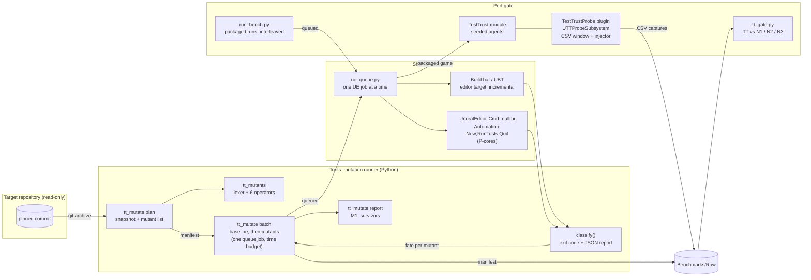

# 02 · System Architecture: TestTrust (v1.0, final)

**Phase:** 3 (Architecture), **final**, 2026-11-21.
**Engine:** UE 5.8.4. Every engine behaviour relied on here is verified in [01b_Research_Findings.md](01b_Research_Findings.md); references like `01b #3` point to its §1 table.
**Rule:** this is the design *before* the code it describes. If implementation proves a decision wrong, this file is updated in the same step.

---

## 1. Goals and non-goals

**Goals**
1. **Mutation score for UE C++ suites:** inject one small fault at a time into gameplay `.cpp` files, rebuild, rerun the suite, and report killed / survived / stillborn per mutant, with the score and the survivor lines.
2. **Never touch the code being measured.** Work on a snapshot taken from a pinned commit; the target repository is only read.
3. **Bounded cost on a shared machine.** Every Unreal job goes through the machine queue; one queue job per batch, each with a time budget and a timeout; batches resume where the last one stopped.
4. **A statistical perf gate** on a deterministic gameplay workload: a single packaged run judged against a baseline with noise bounds, with its false-positive and detection rates measured, not assumed.
5. **Reusable pieces:** the runner works on any UE project with automation tests; the perf probe is a plugin any project can enable.

**Non-goals (v1)**
- Mutating headers, templates or inline functions (UHT and rebuild cost, `01b #2`).
- Binary or IR-level mutation (MSVC; no Clang toolchain in use, `01b` §5).
- Automatic detection of equivalent mutants (reviewed by hand, with reasons).
- Replacing Gauntlet, APT or Horde. TestTrust runs locally and produces files they could ingest later (§11).
- Distributed or parallel mutant execution (one machine, one queue).

## 2. The core ideas in plain words

**Mutation testing.** If you break the code on purpose and every test still passes, the tests don't protect that line. Repeat that for many small, typical mistakes and you get a measure of the suite:

```text
mutation score  =  killed / (killed + survived)      (stillborn and reviewed-equivalent mutants excluded)
```

One mutant's life:

```text
pristine snapshot ──apply one change──► mutated .cpp ──UBT incremental build──► compile error? ─yes─► STILLBORN
                                                                                    │ no
                                              fresh UnrealEditor-Cmd -nullrhi ◄─────┘
                                              "Automation Now;RunTests <filter>;Quit"
                                                   │
                     exit 0, no failure, all tests ran ─► SURVIVED      any failure / missing test ─► KILLED
                     no report (crash) ─► CRASH (counts as killed)      over the time limit ─► TIMEOUT (counts as killed)
                                                   │
                                           restore the pristine text
```

**The perf gate.** A gate answers one question per build: "is the game thread slower than the baseline by more than noise explains?"

```text
baseline: m = 10 packaged runs of the reference build   →  per-run median and p95 of GameThreadTime
          centre c = median of the m values;  spread s = 1.4826 × MAD of the m values
candidate: one packaged run of the new build           →  its median and p95
REGRESSION  if  candidate > c + max(0.10 ms, 3 × s)     for the median OR the p95
```

Both halves follow the same principle: **measure the measuring instrument.** The runner's score is checked against a sample with a known answer (M-S), and the gate's error rates are measured on runs whose truth is known (unchanged builds and injected regressions).

**Rejected alternatives for the core ideas:**

| Alternative | Why we rejected it |
|---|---|
| Line coverage instead of mutation | Unavailable with MSVC on this toolchain (`01b #11`), and it measures *execution*, not *checking*: a test with no assertion gets full coverage |
| Mutant schemata (all mutants compiled in, one chosen at run time) | Needs exact operand boundaries for every expression, i.e. a real C++ parser; with text-level operators the rewritten code would often be wrong. Kept as the main growth path once a Clang front end is available (§11) |
| Frame-level statistics (t-test or Mann–Whitney on all frames) | Frames are autocorrelated; the test would claim confidence the data doesn't have (H5). It is kept only as configuration N3, to *measure* that problem |
| A fixed "+5% vs last run" rule | The status quo (N1); it ignores noise. Kept as a comparison |

## 3. Modules and where they live

```text
D:\UNREAL PORTFOLIO\P03_TestTrust\
├── TestTrust\                                   ← the UE project
│   ├── TestTrust.uproject
│   ├── Source\TestTrust\                        ← game module: the deterministic perf-gate workload (Phase 5)
│   ├── Source\TestTrustSample\                  ← game module: small gameplay rules + their tests (mutation target M-S)
│   ├── Plugins\TestTrustProbe\                  ← runtime plugin: capture window, run metadata, regression injector
│   └── Config\
├── Tools\                                       ← Python + batch scripts (not part of the UE project)
│   ├── tt_mutants.py   tt_mutate.py   tt_common.py   mutation\*.json
│   ├── tt_gate.py   run_bench.py   csv_stats.py      (Phase 5–6)
│   ├── probe_build_cost.py                      (Phase 2 instrumentation)
│   ├── build.bat  package.bat  smoke_game.bat  smoke_packaged.bat  run_tests.bat  phase4_checks.bat
│   └── _work\                                   ← snapshots of target projects (git-ignored)
└── Benchmarks\Raw  Benchmarks\Summaries         ← manifests (committed), logs and captures (ignored), summaries
```

| Module | Type | Responsibility | Depends on |
|---|---|---|---|
| `TestTrustProbe` (plugin) | Runtime | Makes any workload gate-able: reads `-TT…=` options, fires `BenchStart`/`BenchEnd` CSV events after warm-up, writes CSV metadata, injects a known game-thread cost, exits | `Core`, `CoreUObject`, `Engine` |
| `TestTrust` (primary game module) | Runtime | The deterministic gameplay workload: seeded agents running sense → decide → act + compute, a fixed camera path | `Core`, `CoreUObject`, `Engine`, `TestTrustProbe` (private) |
| `TestTrustSample` (game module) | Runtime | Small pure gameplay rules and their automation tests, with one deliberately untested boundary | `Core` |
| `Tools\` (Python) | — | Mutation runner, gate statistics, benchmark orchestration | the machine queue (`tools\ue_queue.py`), git, the engine's `Build.bat` and `UnrealEditor-Cmd` |

**Dependency rules:** game → plugin, never the reverse. `TestTrustSample` depends on nothing but `Core`, so mutating it can't break the workload, and nothing depends on it. The Python tools depend on the UE project only through command lines and files.

**Why `TestTrustSample` is its own module:** a mutation target needs a known, small size and a suite that runs in seconds. Putting the rules into the workload module would make every mutant rebuild and test the workload. The module costs one `Build.cs` and one registration file.

## 4. Components

### 4.1 Mutation runner (Python, `Tools\`)

| Piece | Where | Responsibility | Why this way, and what we rejected |
|---|---|---|---|
| **Campaign** | `tt_mutate.py plan` → `Benchmarks/Raw/<campaign>_manifest.json` | One target at one commit with one mutant list. Holds provenance (repo name, full commit hash), the environment record, every mutant and its fate, every baseline check and batch | One manifest per campaign, rewritten atomically after every mutant, so a batch killed by the queue loses at most the mutant in flight. *Rejected:* a database (overkill), one file per mutant (hard to read and commit) |
| **Snapshot** | `snapshot()`, `check_destination()` | `git archive <commit> <subdir>` into `Tools/_work/<campaign>/` | Reads a commit object, never the working tree: the target is being developed in parallel. Writes only outside the target or into a folder it ignores. *Rejected:* `git worktree` (writes into the target's `.git`), copying the working tree (picks up uncommitted work), `git clone` (needless, and hard-links objects) |
| **Mutant generator** | `tt_mutants.py` | A C++ lexer and six operator families (§7); stable ids; `.cpp` only, function bodies only, assertion/logging macros skipped | No C++ front end in Python; the compiler judges validity, and stillborn mutants are excluded from the score. *Rejected:* regex on raw text (mutates comments and strings), libclang (an extra dependency, kept for growth §11) |
| **Batch** | `tt_mutate.py batch` (inside one queue job) | Restore every target file; build and test the unmutated snapshot (**the suite must be green first**); then one mutant at a time: apply → build → test → classify → restore → save; stop before the time budget would be exceeded | One queue job per batch keeps the machine fair to the other nine projects, and the budget bounds how long the queue is held. *Rejected:* one queue job per mutant (queue overhead and other projects' jobs interleaved between every mutant), one job for the whole campaign (unbounded) |
| **Classifier** | `classify()` (pure function, self-tested) | Fate from the build result, the test exit code and the JSON report, compared with the baseline test count | Both channels are needed: the exit code alone misses "fewer tests ran"; the report alone misses errors outside a test. A mutant survives only if exit = 0, no test failed, and every baseline test ran |
| **Queue driver** | `tt_mutate.py queue` | Submits batches until every mutant has a fate; stops if a batch makes no progress | Waiting in the queue costs no CPU, so the driver can run in the background |
| **Report** | `tt_mutate.py report` → `Benchmarks/Summaries/<campaign>_summary.md` | Fates, M1, M1 before review, M1-naive, per operator, cost per mutant, the survivor table with review verdicts | Survivors are the actionable output: each is a line no test protects |
| **Reviews** | `Tools/mutation/<name>_review.json` | `{mutant id: {verdict, reason}}` for every reviewed survivor: `equivalent` (excluded from M1) or `real gap` (kept) | Equivalence is undecidable in general; a written reason makes each exclusion auditable |
| **Shared helpers** | `tt_common.py` | P-core affinity mask, `pin_self` and the environment record (copied from UE5-UpdateBudget); `pinned()` (added here); the packaged build's paths and the gate's command line (`GATE_ARGS`); `write_json()` (atomic, sanitised manifests) | One place for protocol rules used by both halves |

### 4.2 Perf gate (UE side, Phase 5)

| Class | Kind / base | Responsibility | Why it exists, and what we rejected |
|---|---|---|---|
| `UTTProbeSubsystem` (plugin) | `UTickableWorldSubsystem`; created only with `-TTProbe`, in Game worlds only (never PIE), and runs one window per process | Parses `-TTWarmup=`, `-TTCapture=`, `-TTInjectMs=`, `-TTInjectEvery=`, `-TTRunTag=`, `-TTExit` (finite values, clamped). A pure `FTTProbeWindow` measures the window in the frames' own delta times with a half-frame tolerance; the subsystem fires `CSV_EVENT(BenchStart)` after warm-up and `CSV_EVENT_NOLOG(BenchEnd)` after the capture, writes `CSV_METADATA`, and requests exit. Until `BenchEnd`, on every `-TTInjectEvery`-th frame, it spins the game thread for at least X ms inside `CSV_SCOPED_TIMING_STAT(TestTrustProbe, Injected)` | One tickable subsystem has the right lifetime (the world) and runs on the game thread inside the frame, so injected time lands in `GameThreadTime` (`01b #12`). *Rejected:* a custom `FTickFunction` (not needed: the injection doesn't need a specific tick group), an actor (must be placed or spawned; can be destroyed) |
| `UTTWorkloadSubsystem` (game) | `UTickableWorldSubsystem`, Game and PIE, created only with `-TTAgents=` | Spawns N agents from a fixed seed in `OnWorldBeginPlay` (deferred spawn so state is set before `BeginPlay`), drives the camera along a fixed analytic path, logs start-position and end-state hashes for the determinism check | Copied and adapted from UE5-UpdateBudget's `UUBBenchmarkSubsystem`: no map has to be authored, and spawning from a seed is deterministic. Tickable because the camera moves every frame. In the game module, not the plugin: the plugin is the reusable part, and each project brings its own workload |
| `ATTWorkloadAgent` (game) | `AActor` | A mesh plus one brain component | Nothing else |
| `UTTWorkloadBrainComponent` (game) | `UActorComponent`, native tick in `TG_PrePhysics` | Sense (distance and view cone to the camera) → decide (patrol / alert) → act (move along a patrol circle from accumulated time) → a calibrated compute step | Adapted from UE5-UpdateBudget's `UUBDemoBrainComponent`, minus the budget base class: here the workload only needs to be deterministic and game-thread bound |

### 4.3 Perf gate (Python side, Phase 5–6)

| Piece | Responsibility |
|---|---|
| `run_bench.py` (adapted copy) | Packaged runs, pinned to the P-cores, interleaved with the configuration order rotated every round, one priming run, environment record, raw files moved into `Benchmarks/Raw/` with a manifest |
| `csv_stats.py` (copy) | Per-run median, p95, p99 (linear interpolation), dropping the CSV's two trailing rows |
| `tt_gate.py` | Rules TT, N1, N2, N3 (`01` §6.2) as pure functions of per-run statistics (and, for N3, frames); a `decide` command for one candidate; an `evaluate` command that computes false-positive and detection rates over a batch with known truth |

### 4.4 Sample module (`TestTrustSample`, written in Phase 4)

| Piece | Responsibility |
|---|---|
| `FTTSampleRules` | Plain struct with three static rules: `ComputeDamage` (flat armour, minimum damage, critical doubles), `IsInRange` (squared distance, inclusive), `TickCooldown` (count down, clamp at zero) |
| `TTSampleRulesTests.cpp` | Six automation tests (`TestTrust.Sample.*`), `EditorContext | ClientContext | ProductFilter`. **No test sits exactly on the range limit**, so the mutant `<=` → `<` in `IsInRange` must survive |

The expected outcome is written down before the first run (`09`, P4-R): 14 mutants; the boundary mutant survives; two mutants are equivalent by construction (`Damage < MinDamage` → `<=` when the damage equals the minimum; `Next > 0.f` → `>=` when the remainder is exactly zero); the other 11 are killed.

## 5. Overview diagram



## 6. Flows

### 6.1 One batch (inside one queue job)

```mermaid
sequenceDiagram
  participant B as tt_mutate batch
  participant FS as Snapshot (Tools/_work)
  participant U as Build.bat / UBT
  participant E as UnrealEditor-Cmd (P-cores)
  participant M as Manifest
  B->>FS: restore every target file to its pristine text
  B->>U: build the editor target (unmutated)
  B->>E: Automation Now;RunTests <filter>;Quit (unmutated)
  E-->>B: exit 0 + index.json (N tests, 0 failed), else STOP: suite not green
  loop each pending mutant, while budget allows
    B->>FS: write the mutated .cpp
    B->>U: incremental build (one compile + one DLL link)
    alt compile error
      U-->>B: error Cxxxx → stillborn
    else built
      B->>E: fresh process, timeout = max(120 s, 3 × baseline)
      E-->>B: exit code + index.json → killed / survived / crash / timeout
    end
    B->>FS: restore the pristine text
    B->>M: save the fate, times and failed test names (atomic)
  end
```

### 6.2 One gate run (Phase 5–6)

```text
run_bench.py (pinned to the P-cores) → packaged Binaries\Win64\TestTrust.exe, GATE_ARGS:
               -windowed -ResX=1280 -ResY=720 -nosound -unattended -traceautostart=0 -deterministic -FPS=60 -novsync
               -csvStartOnEvent=BenchStart -csvStopOnEvent=BenchEnd -TTProbe -TTExit
               + -TTAgents=1000 -TTSeed=1 -TTWork=128 -TTWarmup=5 -TTCapture=20 -TTRunTag=<run> [-TTInjectMs=X]
   game:  OnWorldBeginPlay → spawn N agents (seed) ; every frame: agents tick (TG_PrePhysics) → probe Tick (after PostPhysics)
          probe: [spin X ms] ; window: warm-up end → CSV_EVENT(BenchStart) ; capture end → CSV_EVENT_NOLOG(BenchEnd)
          next frame: end-state hash, "BenchEnd on frame" line ; 3 frames later: RequestExit
   after: CSV moved to Benchmarks/Raw → csv_stats.py per-run median/p95/p99 → tt_gate.py decide / evaluate
```

## 7. Defaults and why

**Runner**

| Setting | Default | Reasoning |
|---|---|---|
| Batch time budget | 1,800 s (30 min) | At the probe's measured 15–25 s per `.cpp` mutant on a fast suite (`01b #8–9`), one batch runs about 70–120 mutants; short enough that one project never holds the shared queue for long |
| Queue timeout per batch | budget + 1,200 s | The budget is checked *before* starting a mutant; the margin covers the last mutant, the baseline and teardown |
| Queue idle limit | 900 s | The brief's build limit; build and test logs are written continuously, and the queue watches the campaign's log folder |
| Build timeout per mutant | 1,200 s | A mutant can't legitimately take longer than a cold build; a hung build is an *error*, not a fate of the mutant |
| Test timeout per mutant | max(120 s, 3 × baseline test time) | A mutant that loops forever must be stopped; three times the green run is generous for startup noise |
| Attempts | 2 for *error* fates | An infrastructure failure (for example a locked file) deserves one retry; a second failure is reported, never hidden |
| Files mutated | `.cpp` under the configured globs, minus `Tests/` and module-registration files | Headers re-run UHT and rebuild includers (`01b #2`); tests must never mutate themselves |
| Test launch | `UnrealEditor-Cmd <uproject> -nullrhi -nosound -unattended -nosplash -nopause -traceautostart=0 -ExecCmds="Automation Now;RunTests <filter>;Quit" -ReportExportPath=<dir>`, pinned to the P-cores | No GPU needed; exit code and report give the result (`01b #4–5`); `Now` skips the controller's fixed 5 s start delay (`01b #9`); pinning keeps timeouts stable on the hybrid CPU |
| Test filter | `StartsWith:<prefix>` | A plain filter is a *substring* match (`01b #5`); `StartsWith:` selects exactly one suite |

**Mutation operators** (`tt_mutants.py`; binary operators only with whitespace on both sides)

| Family | Changes | Typical bug it stands for |
|---|---|---|
| ROR | `<`→`<=`,`>=` · `<=`→`<`,`>` · `>`→`>=`,`<=` · `>=`→`>`,`<` · `==`↔`!=` | Off-by-one boundaries, inverted comparisons |
| AOR | `+`↔`-` · `*`↔`/` · `+=`↔`-=` · `*=`↔`/=` | Wrong sign or scale |
| LCR | `&&`↔`||` | Wrong combination of conditions |
| COND | `if (X)` / `while (X)` → `if (!(X))` (not when the condition declares a variable) | Inverted branch |
| BOOL | `true`↔`false` | Wrong default or return value |
| SDL | an assignment, increment or call statement → `;` | A forgotten update or call |

**Gate** (fixed before any gate data exists; changed only on a separate calibration batch, Phase 2 notes C4)

| Setting | Default | Reasoning |
|---|---|---|
| Metric | `GameThreadTime`, per-run median **and** p95 | Gameplay cost lives on the game thread; the median catches shifts, the p95 catches broader slowdowns |
| Baseline size m | 10 runs for the stored baseline (condition b). Under (a), the batch's other `X0` runs: 7 for an `X0` candidate (left out of its own baseline), 8 for an injected one | Enough for a robust centre and spread; about 7 minutes of queue time. Under (a) the size follows from the 8-round batches of `01` §7; it is stated here before any gate data (code review, S3) |
| Rule | median + max(0.10 ms, 3 × 1.4826 × MAD) | Robust three-sigma limit; 0.10 ms floor = 0.6% of a 60 fps frame, below the smallest injected size |
| Candidate runs k | 1 | The success criteria judge single runs. k = 3 (median of three) is a possible extension, not implemented in v1 (`11`) |
| Run length | 5 s warm-up + 20 s capture (1,200 frames at the fixed 60 fps) | A 1,200-frame median is stable; a short run keeps 128-run evaluations inside a few queue batches |
| Workload | N = 1,000 agents, compute step 128 iterations, seed 1 | Game-thread bound near 5 ms in UE5-UpdateBudget's calibration; re-calibrated here in Phase 5 before any gate data |
| Injected sizes | 0, 0.25, 0.5, 1.0 ms | The roadmap's sizes: 5%, 10% and 20% of a ~5 ms game thread |

## 8. Lifetime and safety rules

| Risk | Rule | Evidence |
|---|---|---|
| Writing into the target repository | Only `git rev-parse`, `git archive`, `git check-ignore` with `--no-optional-locks`; the snapshot path is refused if it is inside the target and not ignored there | `check_destination()`; SC2 self-test with a throwaway repository |
| Picking up the target's work in progress | The snapshot comes from a commit object, never the working tree | Self-test plants an uncommitted edit that must not appear |
| A batch killed mid-mutant leaves a mutated file | Every batch starts by restoring every target file from `_pristine/` | `restore()` |
| A red suite makes every mutant look "killed" | The unmutated snapshot must build and pass (and run ≥ 1 test) before any mutant runs | `cmd_batch` refuses with exit 3 |
| A mutant hangs the editor | Test timeout; the whole process tree is killed (`taskkill /T /F`) | `run_step()` |
| A pinned launch hides the exit code | `cmd /v:on /s /c "start … & exit !errorlevel!"`; a plain `cmd /c start /wait` always returns 0 (tested) | `tt_common.pinned()`; `01b #14` |
| UBT links a stale mutant object | Timestamps are never faked; restored files are recompiled | `01b #1` |
| Committed files leak personal paths | Manifests store paths relative to the project, and every manifest is written through `write_json()`, which replaces the user profile path (in all three spellings) | `tt_common.sanitize()`, `write_json()` |
| (Gate) the probe runs in an editor or PIE world | `DoesSupportWorldType`: Game only; not created at all without `-TTProbe` | In PIE, `-TTExit` would quit the whole editor (S1 code review) |
| (Gate) a second world opens a second window | One window per process; map travel during a run is unsupported | S1 code review |
| (Gate) logging inside the last captured frame | `BenchEnd` uses `CSV_EVENT_NOLOG`; the log line moves to the next frame | `CsvProfiler.cpp:4797` (S1 simplify pass) |
| (Gate) the injected time lands outside the frame | The spin runs in the subsystem's `Tick`, on the game thread, inside the frame | `01b #12` |

## 9. Fates and scores

| Fate | Meaning | In M1 |
|---|---|---|
| killed | At least one test failed, or fewer tests completed than in the baseline, or the exit code was non-zero | killed |
| timeout | The test run exceeded its limit | killed (listed separately) |
| crash | The process ended without writing its report | killed (listed separately) |
| survived | Exit 0, no failure, every baseline test ran | survived, unless reviewed equivalent |
| stillborn | The mutant didn't compile | excluded |
| error | Infrastructure failure (build hung, UBT failed without a compile error) | excluded; retried once; must be 0 at the end (SC1) |

- **M1** = killed-like / (killed-like + survived), with reviewed-equivalent survivors removed from both.
- **M1 before review** = the same without the review, so the effect of each exclusion is visible.
- **M1-naive** = (killed-like + stillborn) / (killed-like + stillborn + survived), Mutate++'s rule.

## 10. C++, Blueprint and Python

| C++ | Blueprint | Python |
|---|---|---|
| Everything that runs in the game: the probe, the workload, the sample rules and their tests | Nothing. A gate needs repeatable, version-controlled code; Blueprint adds no value here | Orchestration and statistics: the runner, the gate, benchmark batches. It never runs inside the engine |

## 11. How it grows into a production pipeline (not built now)

- **Nightly CI.** `tt_mutate.py plan` on the night's commit, `queue` across a build farm, report published next to the test results. Only files changed since the last campaign need new mutants.
- **Per-mutant test selection.** Run only the tests that execute the mutated function (needs coverage data; with clang-cl + `llvm-cov`, `01b` §5 growth note).
- **Mutant schemata with a real front end.** libclang (shipped with VS 2022's LLVM) can give exact expression boundaries; then all mutants compile into one binary and a `-TTMutant=<id>` switch selects one per process. Build cost would drop from one build per mutant to one per campaign.
- **Equivalent-mutant shortcuts.** Trivial compiler equivalence (identical object files mean an equivalent mutant) needs deterministic compiler output, which the launcher editor target can't enable (`01b #13`).
- **Gate in CI.** A pre-merge gate with k = 3 candidate runs; a nightly re-baseline; results exported as Gauntlet/Horde telemetry instead of local files.
- **Reuse across the portfolio.** UE5-SpawnPacer and later projects can enable `TestTrustProbe` to make their benchmarks gate-able, and point the runner at their suites.

## 12. Known limits (stated, not hidden)

1. **Text-level operators.** Some mutants won't compile (stillborn); a few compile but are equivalent. Both are reported, neither inflates the score.
2. **`.cpp` only.** Logic in headers (inline functions, templates) is not mutated in v1.
3. **One machine.** Costs and gate error rates are for this laptop and this protocol.
4. **The gate is tested on synthetic regressions.** A spin-wait is a clean shift; spiky regressions are explored, not part of the success criteria.
5. **A single-run gate has a floor.** It can't detect a change smaller than the run-to-run noise; that floor is measured, not assumed.
6. **One capture window per process, one map.** The probe doesn't survive map travel during a run (it refuses a second window instead); the gate's workload never changes map.

## 13. Changes from the plan

| Change | Why |
|---|---|
| Mutants build the **editor** target and test in `UnrealEditor-Cmd`, not a packaged game | The editor target is modular: a mutant relinks one module DLL instead of the whole game executable (`01b #8`, probe in `09` P2) |
| Only `.cpp` files are mutated | Header mutants re-run UHT and rebuild every includer (`01b #2`, probe) |
| The snapshot must not be a git checkout | On the launcher engine, a folder without `.git` makes every writable file part of the adaptive-unity working set, so each file compiles alone and the set never changes between mutants (`01b #3`) |
| A fourth configuration family: stored vs interleaved baseline (SC5 a/b) | Laptop drift between sessions is a hypothesis (H4), so the gate is measured both ways |
| A reusable probe plugin instead of gate code in the game module | The roadmap wants the gate to protect later projects; a plugin is the unit of reuse |
| Pinned launches use `cmd /v:on /s /c "start … & exit !errorlevel!"` | The plain `start /wait` form hides exit codes (`01b #14`) |
