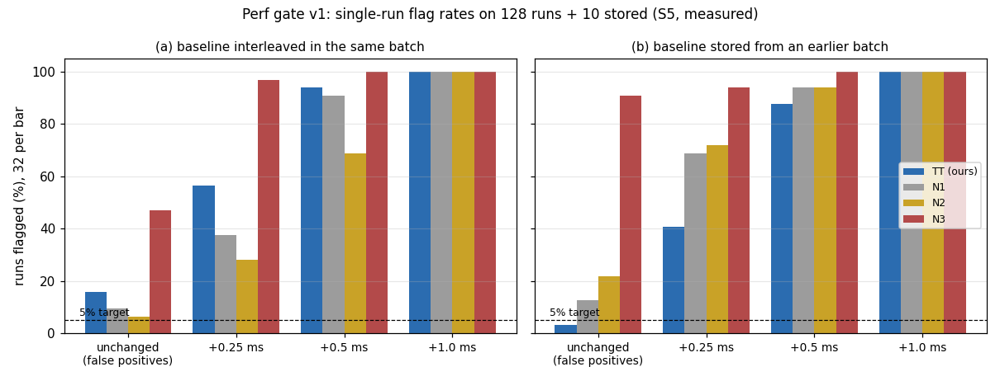
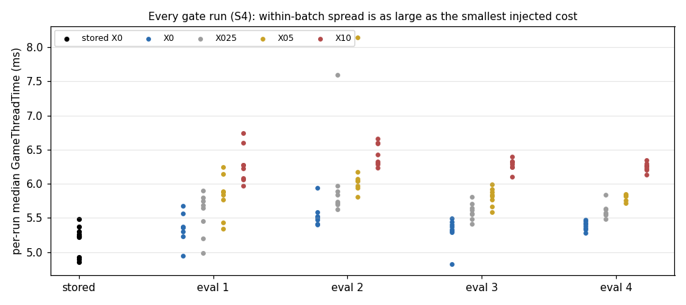

# P03 · TestTrust: measuring whether tests actually catch bugs

**Author:** Krish Gangani · [github.com/KrishGangani](https://github.com/KrishGangani)

**Domain:** Debugging & automated testing · **Difficulty:** ★★★★☆ · **Engine:** UE 5.8.4

> **Status: finished (v1).** Phases 1–6 are done. Phase 7 was cut short by owner direction, and gate v2, further campaigns and a demo video were dropped. Every number below is measured; anything unmeasured is marked so. Sections marked *(pending)* are filled in only from real measurements, in the phase named. The success criteria are **targets fixed before the code they judge**, not results.

| Phase | 1 Problem | 2 Research | 3 Architecture | 4 Foundation | 5 Implementation | 6 Explanation | 7 Testing | 8 Profiling | 9 Review | 10 Portfolio |
|---|---|---|---|---|---|---|---|---|---|---|
| State | ✓ | ✓ | ✓ final | ✓ | ✓ | ✓ | partial | partial (no v2) | — | ✓ (no video) |

---

## Problem statement

A green test run says every test passed. It doesn't say which bugs the tests would have caught: a test can call a function and never check its result, and a boundary such as `<` versus `<=` can be wrong with every test still passing. Gameplay performance regressions of a fraction of a millisecond are just as invisible, and naive "+5% vs last run" checks drown in run-to-run noise. Unreal ships good frameworks for writing tests and an Experimental harness for capturing performance; it ships nothing that **measures the suite** or **decides statistically** whether gameplay got slower. Details: [Explanation/01_Problem_Analysis.md](Explanation/01_Problem_Analysis.md).

## Engineering approach

**Mutation runner.** Snapshot the target project at a pinned commit (never touching its repository), inject one small fault at a time into a gameplay `.cpp` file (six operator families: relational, arithmetic, logical, condition, boolean, statement deletion), rebuild incrementally, run the suite in a fresh `UnrealEditor-Cmd -nullrhi`, and classify the mutant as killed, survived or stillborn from the exit code **and** the JSON report. The score is killed / (killed + survived); the survivors are the lines no test protects. Batches run through the machine's job queue with a time budget and resume where they stopped. Mutation testing itself is decades old; the work here is making it practical with MSVC, UnrealBuildTool and UHT, and measuring its cost.

**Perf gate.** A reusable plugin (`TestTrustProbe`) opens and closes a CSV capture window and can inject an exact game-thread cost. A single packaged run of a deterministic gameplay workload is judged against a 10-run baseline with a robust rule (median + max(0.10 ms, 3 × MAD) on the run's median and p95 game-thread time). Its false-positive and detection rates are **measured** on unchanged and injected runs and compared with naive gates on the same data. Details: [Explanation/02_System_Architecture.md](Explanation/02_System_Architecture.md).

## What already exists (and the gap)

Automation tests, Automation Spec, CQTest, Functional Tests and Gauntlet (Beta) for writing and running tests; the Automated Perf Testing plugin (Experimental) and Horde dashboards for capturing and viewing performance. None measures a suite's fault-detection ability; coverage is unavailable with MSVC in the stock toolchain (UBT's `-CodeCoverage` acts only with Clang); none of the locally readable tools makes a statistical pass/fail decision on gameplay performance. **Gap: strong for suite effectiveness; medium for perf gating**, where the statistics are standard and the contribution is a measured, local, gameplay-focused gate. Evidence: [Explanation/01b_Research_Findings.md](Explanation/01b_Research_Findings.md).

## Architecture diagram

Final (v1.0): [Explanation/02_System_Architecture.md](Explanation/02_System_Architecture.md) §5–6.

## Before / after comparison

- **Mutation, UE5-UpdateBudget's scheduler** (`b890bc6`, 39 mutants): M1 **92.1%** with its own 8 tests; three survivors were real boundary gaps. Three tests written from the survivor list, applied as a patch to a snapshot only, raise it to **100%** (one survivor left, reviewed as equivalent). Median cost **13.9 s per mutant** over 106 mutants. [09 S6–S8](Explanation/09_Testing_And_Benchmarks.md).
- **Gate:** single-run detection 100% at +1.0 ms, 94% / 88% at +0.5 ms and 56% / 41% at +0.25 ms (interleaved / stored baseline), with 15.6% / 3.1% false positives on 32 unchanged runs. The ≤ 5% target holds only against the stored baseline, and the TestTrust rule does not beat the naive gates on every rate: SC5–SC7 are partly **not met**, reported as measured. [09 S5](Explanation/09_Testing_And_Benchmarks.md).

## Benchmark results

The pass/fail criteria were fixed in advance ([01 §6.4](Explanation/01_Problem_Analysis.md)). Final status, from existing data only ([09](Explanation/09_Testing_And_Benchmarks.md)):

| # | Criterion | Result |
|---|---|---|
| SC1 | Runner trustworthy: 0 errors; repeat gives the same fates | ✅ 14 of 14 mutants with the same fate; 0 errors |
| SC2 | Never writes into a target repository | ✅ by construction, plus a self-test |
| SC3 | Median ≤ 60 s per `.cpp` mutant | ✅ 13.9 s over 106 mutants |
| SC4 | Survivor tests raise M1 to ≥ 90% | ✅ 92.1% → 100% |
| SC5 | Gate false positives ≤ 5% (interleaved and stored) | ❌ 15.6% interleaved; ✅ 3.1% stored |
| SC6 | Detection 100% / 95% / 80% at 1.0 / 0.5 / 0.25 ms | ✅ 100% at 1.0 ms; ❌ 88–94% at 0.5 ms; ❌ 41–56% at 0.25 ms |
| SC7 | Better than three naive gates on every rate | ❌ not met |
| SC8 | One decision ≤ 90 s | ✅ about 12 s |





Both charts are drawn from the committed manifests by `Tools/make_charts.py`. Raw data: [Benchmarks/](Benchmarks/README.md).

## Recorded demonstration

Not recorded: the video was dropped by owner direction. The mutation reports are in [Benchmarks/Summaries/](Benchmarks/Summaries/), and the gate charts are above.

## Source code

- The UE project is in [TestTrust/](TestTrust/) (UE 5.8.4, C++): the reusable probe is the plugin `TestTrustProbe`; the workload is the game module `TestTrust`; the runner's sample target is the module `TestTrustSample`.
- The runner and the statistics are Python, in [Tools/](Tools/) (`tt_mutate.py`, `tt_mutants.py`, `tt_common.py`; the gate: `run_bench.py`, `csv_stats.py`, `tt_gate.py`; step checks: `run_checks.py`).

## Documentation

| File | Contents |
|---|---|
| [00_Project_Overview](Explanation/00_Project_Overview.md) | Identity, demonstration, presentation, industry relevance |
| [01_Problem_Analysis](Explanation/01_Problem_Analysis.md) | Problem, existing work, root-cause hypotheses, success criteria, measurement plan |
| [01b_Research_Findings](Explanation/01b_Research_Findings.md) | Phase 2: verified engine behaviour (UE 5.8.4), the measured cost of a mutant, and what it changed in the design |
| [02_System_Architecture](Explanation/02_System_Architecture.md) | Final v1.0: modules, components, flows, defaults, safety rules, fates and scores, rejected alternatives |
| [03_Implementation_Roadmap](Explanation/03_Implementation_Roadmap.md) | The ordered build steps; baselines captured before the new system is evaluated |
| [04](Explanation/04_CPP_Fundamentals.md) · [05](Explanation/05_Line_By_Line_Code_Explanation.md) · [06](Explanation/06_Unreal_APIs_And_Macros.md) · [07](Explanation/07_Common_Mistakes.md) | C++ fundamentals, line-by-line code, APIs and macros, common mistakes (current to Phase 5) |
| [09](Explanation/09_Testing_And_Benchmarks.md) | Every check so far: the build-cost probe, the Phase 4 checks, the runner smoke test, and Phase 5's step checks, mutation campaigns and gate batches |
| [08](Explanation/08_Debugging_And_Profiling.md) · [10](Explanation/10_Interview_Questions.md) · [11](Explanation/11_Optimization_Decisions.md) · [12](Explanation/12_Future_Scalability.md) | Debugging and profiling, interview questions, optimisation inputs (Phase 5), future scalability |
| [Research/](Explanation/Research/) | The portfolio-wide research this project draws on: job market, technical challenges, existing solutions, local engine verification |

## Folder layout

```text
P03_TestTrust\
├── README.md        ← this page
├── Explanation\     ← 00–12, 01b, Phase2_Raw_Notes\, Research\
├── Benchmarks\      ← Raw\ (manifests committed) + Summaries\
├── Media\           ← diagrams, screenshots, demo video
├── Tools\           ← runner, statistics, build and run scripts; _work\ snapshots (git-ignored)
└── TestTrust\       ← the Unreal Engine project
```

## License

MIT, see [LICENSE](LICENSE). Unreal Engine itself is not included and is covered by Epic Games' own license.
